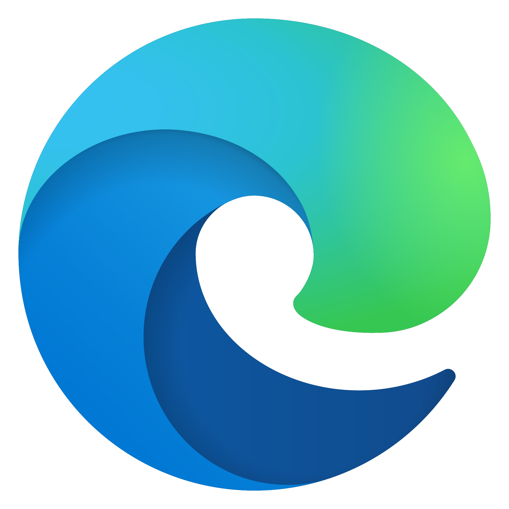
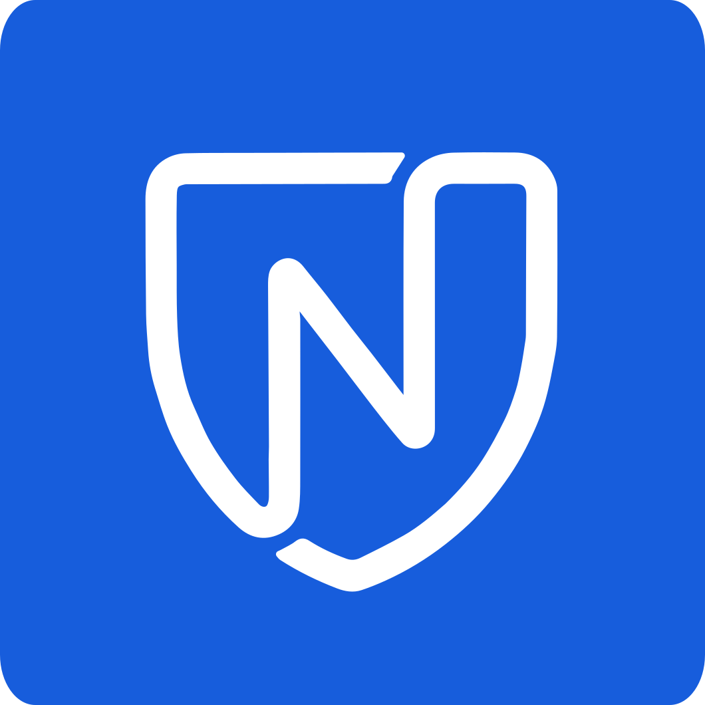

# NodeAuth

The sovereign, cross-platform 2FA & TOTP authenticator ecosystem across mobile apps, browser extensions, and self-hosted backends.

---

## 📱 Mobile Apps

<table>
  <tr>
    <th align="left" width="210">Platform / Channel</th>
    <th align="left" width="210">Download</th>
    <th align="left">Details</th>
  </tr>
  <tr>
    <td><b>iOS / iPadOS</b></td>
    <td>&nbsp; <a href="https://apps.apple.com/cn/app/nodeauth/id6820337516" style="text-decoration: none;"><b>App Store</b></a></td>
    <td>Compatible with iPhone and iPad</td>
  </tr>
  <tr>
    <td><b>Android (Google Play)</b></td>
    <td>&nbsp; <a href="https://play.google.com/store/apps/details?id=com.nextmatrix.nodeauth" style="text-decoration: none;"><b>Google Play</b></a></td>
    <td>Official release on Google Play Store</td>
  </tr>
  <tr>
    <td><b>Android (Direct APK)</b></td>
    <td>&nbsp; <a href="https://github.com/nextmatrixllc/nodeauth/releases/latest/download/NodeAuth.apk" style="text-decoration: none;"><b>NodeAuth.apk</b></a></td>
    <td>Official standalone APK for Android devices</td>
  </tr>
</table>

---

## 🧩 Browser Extensions

<table>
  <tr>
    <th align="left" width="210">Browser</th>
    <th align="left" width="210">Install</th>
    <th align="left">Compatibility</th>
  </tr>
  <tr>
    <td><b>Chromium Browsers</b></td>
    <td>&nbsp; <a href="https://chromewebstore.google.com/detail/nodeauth/ejknfokfdojopelcbidgchnopeapnjgd" style="text-decoration: none;"><b>Chrome Web Store</b></a></td>
    <td>Compatible with Google Chrome, Brave, Arc, Vivaldi, Opera, etc.</td>
  </tr>
  <tr>
    <td><b>Microsoft Edge</b></td>
    <td>&nbsp; <a href="https://microsoftedge.microsoft.com/addons/detail/nodeauth/bclpbakllopgjhelikbhccpjkgbmfpgd" style="text-decoration: none;"><b>Edge Add-ons</b></a></td>
    <td>Official Microsoft Edge Add-ons</td>
  </tr>
  <tr>
    <td><b>Mozilla Firefox</b></td>
    <td>&nbsp; <a href="https://addons.mozilla.org/zh-CN/firefox/addon/nodeauth" style="text-decoration: none;"><b>Firefox Add-ons</b></a></td>
    <td>Official Firefox Add-ons</td>
  </tr>
</table>

---

## 🖥️ Self-Hosted Server (BYOS)

<table>
  <tr>
    <th align="left" width="210">Component</th>
    <th align="left" width="210">Link</th>
    <th align="left">Description</th>
  </tr>
  <tr>
    <td><b>BYOS Repository</b></td>
    <td>&nbsp; <a href="https://github.com/nodeauth/nodeauth-byos" style="text-decoration: none;"><b>nodeauth-byos</b></a></td>
    <td>Sovereign 2FA/TOTP backend and web vault, supporting Cloudflare Serverless and Docker deployment</td>
  </tr>
  <tr>
    <td><b>Documentation</b></td>
    <td>&nbsp; <a href="https://wiki.nodeauth.io/" style="text-decoration: none;"><b>Documentation Wiki</b></a></td>
    <td>Complete step-by-step deployment guides (Cloudflare / Docker), automated backup strategies, and tutorials</td>
  </tr>
  <tr>
    <td><b>Live Demo</b></td>
    <td>&nbsp; <a href="https://demo.nodeauth.io" style="text-decoration: none;"><b>demo.nodeauth.io</b></a></td>
    <td>Online interactive demo instance to preview web vault features and UI</td>
  </tr>
</table>
